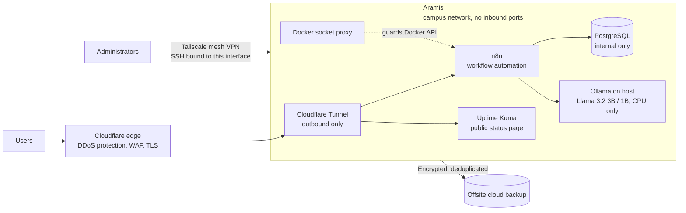

# Aramis

Aramis is a self hosted server built for student and faculty projects at Instituto Tecnológico de Hermosillo. It runs workflow automation, a public status page, and a local AI model. It was built on a reused workstation, with security in mind from the start.

## Goals

The project has 3 goals. It gives students a real platform where they can build and show their automation and AI projects. It keeps the server hidden from the public internet while its services remain reachable. It runs on reused hardware with no licensing cost.

## Hardware

The server is a Dell Precision Tower 5810 with an Intel Xeon E5 1620 v4 processor (4 cores and 8 threads), 16 GB of ECC DDR4 memory, and a 232 GB NVMe drive. It runs Ubuntu 26.04.1 LTS. The installed graphics card is an NVIDIA Quadro K420, which is too old for AI workloads, so the AI model runs on the processor instead.

## Deployment

The server sits on the campus network with a fixed address assigned by the IT department. The network settings live in a configuration file tied to the built in network port, so the address stays the same after every restart.

## Architecture

### How traffic reaches the server

Public visitors never connect to the server directly. They reach Cloudflare first, and Cloudflare passes their requests through a tunnel that the server opens from the inside. Because of this, the server's address is never exposed and no inbound ports are open on the network.

Administrators connect through a private Tailscale VPN using key based login. Remote login is only allowed on that VPN connection, so it cannot be reached from the campus network.

## Services

| Service | Purpose | Exposure |
|---|---|---|
| n8n | Workflow automation for student projects | Public, behind Cloudflare |
| Uptime Kuma | Public status page for services | Public, behind Cloudflare |
| PostgreSQL | Database for n8n | Internal only |
| Ollama (Llama 3.2 3B and 1B) | Local AI model, no data leaves the server | Internal only |
| Docker socket proxy | Limits what containers can do with the Docker API | Internal only |

Every service except Ollama runs in its own Docker container. Each group of services has its own isolated network, every container has limits on how much processor time and memory it can use, and all of them are managed from a single configuration file, which keeps updates predictable. All file paths in that configuration are written out in full, so the services behave the same no matter which user starts them.

### Local AI

Ollama runs directly on the server rather than in a container, and n8n talks to it over an internal connection. Students use it through a chat workflow inside n8n, so the AI service itself is never exposed to the network.

Two versions of the Llama 3.2 model are available. The larger 3B model gives better answers, and the smaller 1B model responds about three times faster. Since everything runs on the processor, answers are slow and requests are handled one at a time. This works well for learning and demonstrations.

## Security

| Layer | Tool | Role |
|---|---|---|
| Edge | Cloudflare | DDoS mitigation, bot protection, managed WAF |
| Transport | Cloudflare Tunnel | Hides the origin, no inbound exposure |
| TLS | Cloudflare | Full (strict) TLS, HSTS, TLS 1.2 minimum, HTTP/3 |
| Firewall | UFW | Default deny inbound, remote login allowed only over the VPN |
| Access | OpenSSH + Tailscale | Key only auth, no root login, no passwords |
| Brute force | Fail2ban | Bans repeated failed logins |
| Threat intel | CrowdSec | Community blocklists and behavior detection |
| Patching | Unattended Upgrades | Automatic security updates |
| Containers | Socket proxy, network isolation | Limits the damage a compromised container can do |
| Auditing | Lynis | Monthly system hardening audit |
| Vulnerabilities | Trivy | Monthly container image scanning |

## Backups

Backups are made with Restic and sent to offsite cloud storage through Rclone. They are encrypted and deduplicated, so they stay small over time.

The backups cover service settings, application data, system configuration, and the credentials needed to run the backups themselves. Before each backup, the n8n database is exported to a file so its data can be restored cleanly. Container images are not included because they can always be downloaded again.

A backup runs every night, followed by a cleanup that keeps seven daily, four weekly, and three monthly copies. With these backups alone, the services can be rebuilt on new hardware.

## Operations

Once a month, the server goes through a maintenance routine. Every container image is scanned for vulnerabilities, images are updated and old ones are removed, the hardening audit is run and compared against a target score, the threat detection numbers are reviewed, and the backups are checked.

A set of health check scripts reports on the containers, system services, public access, the backup connection, and available disk space and memory. A separate connectivity script checks every outside service the server depends on, so any change in the network policy shows up right away instead of breaking something quietly.
