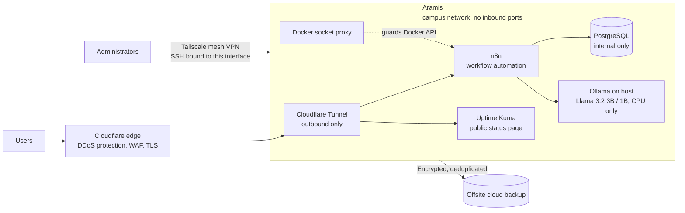

# Aramis
 
A self hosted server built for student and faculty projects at Instituto Tecnológico de Hermosillo. It runs workflow automation, a public status page, and a local AI model, built on repurposed workstation hardware with a security first design.
 
## Goals
 
- Give students a real platform to build and showcase automation and AI projects
- Keep the server off the public internet while its services stay reachable
- Run on modest, reused hardware with zero licensing cost
- Document everything so the setup can be maintained and handed over
## Hardware
 
| Component | Spec |
|---|---|
| Model | Dell Precision Tower 5810 |
| CPU | Intel Xeon E5-1620 v4 (4 cores, 8 threads) |
| RAM | 16 GB ECC DDR4 |
| Storage | 232 GB NVMe |
| GPU | NVIDIA Quadro K420 (below the minimum for GPU inference, so AI runs on CPU) |
| OS | Ubuntu 26.04.1 LTS |
 
## Deployment
 
The server is deployed on campus on the institutional network with a static address assigned by IT. Network configuration is declared in netplan on the onboard ethernet interface, so addressing survives reboots and does not depend on DHCP or a USB adapter.
 
The campus network originally required an outbound HTTP proxy and blocked DNS on port 53. That combination broke the Cloudflare Tunnel, because tunnel discovery relies on DNS SRV lookups that cannot traverse an HTTP proxy. After a request to the network administrator, outbound DNS was permitted and the server's address was exempted from the proxy. The proxy configuration remains documented and commented in place so it can be restored quickly if network policy changes.
 
Lesson worth recording: on a restricted network, test DNS resolution independently of HTTP connectivity. A proxy that passes HTTPS cleanly can still leave a service dead if it depends on raw DNS.
 
## Architecture

**How traffic reaches the server**

- Public traffic never reaches the server directly. Users hit Cloudflare's edge, which forwards requests through an outbound only tunnel.
- The server's IP address is never exposed, and no inbound ports are opened on the network.
- Administrative access goes only over a private Tailscale mesh VPN with key based authentication.
- SSH is bound to the VPN interface, so port 22 is not reachable from the campus LAN even for machines on the same subnet.

## Services
 
| Service | Purpose | Exposure |
|---|---|---|
| n8n | Workflow automation for student projects | Public, behind Cloudflare |
| Uptime Kuma | Public status page for services | Public, behind Cloudflare |
| PostgreSQL | Database for n8n | Internal only |
| Ollama (Llama 3.2, 3B and 1B) | Local AI model, no data leaves the server | Internal only |
| Docker socket proxy | Limits what containers can do with the Docker API | Internal only |
 
All services except Ollama run as Docker containers, with:
 
- Isolated Docker networks per service group
- CPU and memory limits on every container
- A single master compose file for predictable updates
- Absolute paths in every compose file, so volume mounts resolve identically regardless of which user invokes Docker
### Local AI
 
Ollama runs directly on the host rather than in a container, and is reachable from n8n over the Docker host gateway. Students use it through an n8n chat workflow rather than direct API access, which keeps the inference port off the network entirely.
 
Two model sizes are available. The 3B model gives better answers; the 1B model is roughly three times faster. Inference is CPU only because the installed GPU falls below Ollama's compute capability minimum, so throughput sits in the low single digits of tokens per second and requests are served one at a time. This is adequate for learning and demonstration. It is not adequate for a full classroom working concurrently, and that limitation should be stated plainly to anyone using it.
 
## Security
 
| Layer | Tool | Role |
|---|---|---|
| Edge | Cloudflare | DDoS mitigation, bot protection, managed WAF |
| Transport | Cloudflare Tunnel | Hides the origin, no inbound exposure |
| TLS | Cloudflare | Full (strict) TLS, HSTS, TLS 1.2 minimum, HTTP/3 |
| Firewall | UFW | Default deny inbound; SSH restricted to the VPN interface |
| Access | OpenSSH + Tailscale | Key only auth, no root login, no passwords |
| Brute force | Fail2ban | Bans repeated failed logins |
| Threat intel | CrowdSec | Community blocklists and behavior detection |
| Patching | Unattended Upgrades | Automatic security updates |
| Containers | Socket proxy, network isolation | Limits the blast radius of a compromised container |
| Auditing | Lynis | Monthly system hardening audit |
| Vulnerabilities | Trivy | Monthly container image scanning |
 
### Known exposure
 
n8n is the most exposed component: it is publicly reachable and it executes user supplied code. Code node access is restricted to trusted users as a mitigation. Container image vulnerabilities are tracked monthly and remediated when upstream fixes ship.
 
## Backups
 
- **Tooling:** Restic for backups, Rclone as transport to offsite cloud storage
- Encrypted at rest and deduplicated, so the long term footprint stays small
- **Scope:** service configurations, application data, system configuration, and administrative state including credentials for the backup transport itself. A database dump runs before each backup so application data is captured in a restorable form rather than as live database files. Container images are excluded because they can be pulled again.
- **Schedule:** automated daily backups with nightly pruning
- **Retention:** 7 daily, 4 weekly, 3 monthly snapshots
Restoring from backup alone is sufficient to rebuild the service layer on new hardware.
 
## Operations
 
A monthly maintenance cycle covers:
 
- Vulnerability scanning of every running container image
- Image updates, then cleanup of unused images
- A system hardening audit, tracked against a target score
- A review of threat detection metrics
- Backup verification
A set of health check scripts covers containers, system services, public reachability, backup transport, and disk and memory headroom. A companion connectivity script verifies every external dependency the server relies on, which makes network policy changes immediately visible rather than surfacing later as a silent failure.
